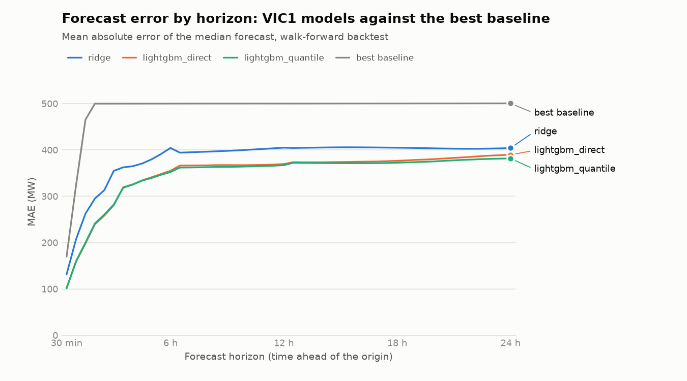
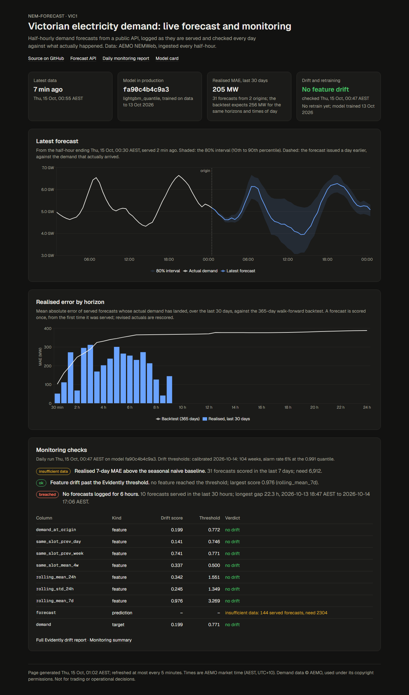
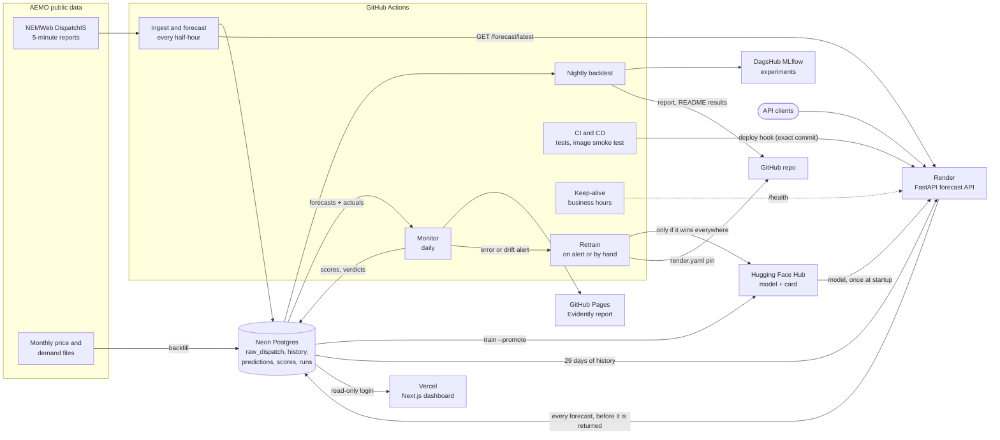

# nem-forecast

[](https://github.com/proxykhan/nem-forecast/actions/workflows/cd.yml)
[](https://github.com/proxykhan/nem-forecast/actions/workflows/cd.yml)

[](https://huggingface.co/Azharkhan79/nem-forecast-vic1)
[](LICENSE)

Half-hourly electricity demand forecasts for Victoria (`VIC1`) in Australia's National
Electricity Market, from 30 minutes to 24 hours ahead, each with a 10th-90th percentile range.
It ingests AEMO's public 5-minute data every half-hour, evaluates every model against honest
baselines in a walk-forward backtest, tracks experiments, publishes the winning model with a
generated model card, and serves forecasts from an API that records every forecast it gives out.
Every logged forecast is then scored against the demand that actually arrived, inputs and outputs
are checked for drift daily, and a retrained model reaches production only by beating the served
one at every horizon. Demand forecasting in Victoria is hard in ways a tutorial hides:
rooftop solar removes a weather-dependent slice of demand in the middle of the day, so the
hardest hours are now noon rather than the evening peak; AEMO keeps its clock on fixed AEST while
people live on daylight-saving time; published values are revised after the fact; and a forecast
made for tomorrow may only use what was known today, a rule that is easy to break silently with
lag features.

| | |
|---|---|
| **Live API** | [nem-forecast-api.onrender.com/docs](https://nem-forecast-api.onrender.com/docs) (free tier: the first request after a quiet spell takes about a minute) |
| **Experiments** | [MLflow on DagsHub](https://dagshub.com/proxykhan/nem-forecast.mlflow/#/experiments): every backtest, fold and tuning trial |
| **Model card** | [Azharkhan79/nem-forecast-vic1](https://huggingface.co/Azharkhan79/nem-forecast-vic1), versioned by git SHA |
| **Dashboard** | [nem-forecast.vercel.app](https://nem-forecast.vercel.app/): latest forecast against actuals, realised error, drift checks, last retrain |
| **Monitoring report** | [proxykhan.github.io/nem-forecast](https://proxykhan.github.io/nem-forecast/): daily checks and the Evidently drift report |
| **Backtest report** | [docs/backtest](docs/backtest/README.md), regenerated nightly |

## Results

Every model is scored on exactly the same forecasts as four baselines: same-time-yesterday,
same-time-last-week, the mean of the last four same weekdays, and persistence (the last value,
held flat: the honest short-horizon bar). The tables below are regenerated by the nightly
backtest.

<!-- results:start -->
Walk-forward backtest over 2025-10-27 to 2026-10-27, 840,168 forecasts per model, refreshed nightly (last run 2026-10-27; [full report](docs/backtest/README.md)).

| Model | Kind | MAE (MW) | MAPE (%) | Pinball avg (MW) | 10-90 coverage (%) |
|---|---|--:|--:|--:|--:|
| LightGBM quantile | model | 346 | 7.4 | 113.1 | 67.9 |
| LightGBM direct | model | 349 | 7.5 | 122.1 | 77.4 |
| Ridge | model | 382 | 8.2 | 131.0 | 77.9 |
| 4-week same-weekday mean | baseline | 500 | 10.8 | 177.1 | 75.2 |
| Seasonal naive | baseline | 504 | 10.9 | 177.7 | 80.1 |
| Weekly seasonal naive | baseline | 593 | 13.0 | 209.6 | 79.5 |
| Persistence | baseline | 971 | 20.7 | 300.1 | 79.5 |

**MAE (MW) by horizon**

| Model | 30 min | 1 h | 2 h | 3 h | 6 h | 12 h | 18 h | 24 h |
|---|--:|--:|--:|--:|--:|--:|--:|--:|
| LightGBM quantile | 101 | 160 | 241 | 282 | 352 | 367 | 372 | 382 |
| LightGBM direct | 101 | 159 | 240 | 281 | 355 | 370 | 377 | 390 |
| Ridge | 131 | 207 | 295 | 355 | 404 | 405 | 405 | 404 |
| 4-week same-weekday mean | 500 | 500 | 500 | 500 | 500 | 500 | 500 | 500 |
| Seasonal naive | 504 | 504 | 504 | 504 | 504 | 504 | 504 | 504 |
| Weekly seasonal naive | 593 | 593 | 593 | 593 | 593 | 593 | 593 | 593 |
| Persistence | 170 | 323 | 598 | 828 | 1,180 | 1,001 | 1,198 | 504 |

**Pinball loss, average of q10/q50/q90 (MW), by horizon**

| Model | 30 min | 1 h | 2 h | 3 h | 6 h | 12 h | 18 h | 24 h |
|---|--:|--:|--:|--:|--:|--:|--:|--:|
| LightGBM quantile | 35 | 53 | 79 | 92 | 115 | 120 | 121 | 124 |
| LightGBM direct | 35 | 55 | 83 | 98 | 124 | 129 | 132 | 137 |
| Ridge | 45 | 70 | 100 | 120 | 138 | 139 | 139 | 139 |
| 4-week same-weekday mean | 177 | 177 | 177 | 177 | 177 | 177 | 177 | 177 |
| Seasonal naive | 178 | 178 | 178 | 178 | 178 | 178 | 178 | 178 |
| Weekly seasonal naive | 210 | 210 | 210 | 210 | 210 | 210 | 210 | 210 |
| Persistence | 53 | 101 | 186 | 255 | 358 | 309 | 367 | 178 |

- **LightGBM quantile**: Beats seasonal naive at all 48 horizons. Beats the best baseline at each horizon at all 48 horizons.
- **LightGBM direct**: Beats seasonal naive at all 48 horizons. Beats the best baseline at each horizon at all 48 horizons.
- **Ridge**: Beats seasonal naive at all 48 horizons. Beats the best baseline at each horizon at all 48 horizons.
<!-- results:end -->



What the numbers do and do not show:

- **The improvement shrinks with distance.** 30 minutes ahead, the models know the demand
  ramp they are on; a day ahead, without weather inputs, there is little to go on beyond the
  calendar and the recent level.
- **The midday solar trough is the hardest time of day** for every model and baseline, at
  roughly 3-4 times the overnight error: rooftop solar depends on cloud cover, which nothing here
  can see. Weather data is the obvious next feature.
- **The published model's 10-90 range is too narrow.** LightGBM quantile has the best pinball
  loss because its ranges are sharp, but they hold about 69% of actual demand rather than 80%. The
  model card says so; LightGBM direct's out-of-sample ranges are better calibrated.
- **Tuning bought little:** 50 Optuna trials improved validation MAE by 3.6%. The features matter
  far more than the hyperparameters.

## Live: does the backtest hold up?



The [dashboard](https://nem-forecast.vercel.app/) and the daily
[monitoring report](https://proxykhan.github.io/nem-forecast/) score every forecast the live API
has served against the demand that actually arrived (see [Monitoring](#monitoring-and-retraining)).

**As of the evening of 15 October 2026**, a day and a half after the forecast client started,
267 forecasts from 8 origins have been scored:

| Horizons | Forecasts | Realised MAE (MW) | Backtest MAE for the same forecasts (MW) | Ratio |
|---|--:|--:|--:|--:|
| 30 min | 8 | 76 | 93 | 0.82 |
| 1-1.5 h | 16 | 147 | 162 | 0.91 |
| 2-3 h | 24 | 178 | 256 | 0.70 |
| 3.5-6 h | 46 | 267 | 316 | 0.84 |
| 6.5-12 h | 79 | 487 | 421 | 1.16 |
| 12.5-24 h | 94 | 439 | 472 | 0.93 |
| **All** | **267** | **372** | **381** | **0.98** |

**Live error matches the backtest: 0.98 of what it predicts for these forecasts.** The first
look, on 37 forecasts in the early hours of that day, had put the ratio at 0.81; with seven times
the data it has converged to the backtest, which is what an honest backtest should do. The one group running
worse, 6.5-12 hours ahead (1.16), rests on 79 forecasts from 7 origins, and its excess comes
from one place: the 34 that targeted the 10:00-16:00 solar window on 15 October were *all*
over-forecast, by 823 MW on average. A one-sided miss at midday is the signature of more rooftop
solar than usual, which this model cannot see (it has no weather inputs). It is the backtest's
known weak spot showing up live, on one day; a group to watch, not yet a finding. The monitor
republishes this table daily, and the realised-error alert waits for at least 1,000 scored
forecasts over three different days before it judges anything.

**Comparing like with like.** The headline backtest MAE (351 MW) is a year-long average over
every horizon and every hour. Live forecasts arrive in a very different mix: a forecast issued in
the evening has only its first few horizons scored by the next morning, and those fall
overnight, when demand is easiest to forecast. Set against 351 MW, the first live figure of
193 MW looked 45% better than the backtest. That was an artefact of the mix, not a better model.
So the monitor never compares with the headline figure. It takes the backtest's MAE for each (horizon,
time-of-day) cell, weights it by how many live forecasts fell in that cell, and compares against
that: the error the backtest predicts for *these* forecasts.

Two findings from putting monitoring on a real feed:

- **Evidently's default drift threshold would have fired every week.** Scored against its own
  seasonal reference, every one of the last 104 weeks crossed the default (normed Wasserstein
  distance 0.1) on at least one feature. Weekly demand moves with the weather far more than
  that, and this model has no weather inputs, so "drift" at 0.1 is just a cold week. The
  thresholds are instead calibrated on that history: each feature's threshold sits at the 0.991
  quantile of its own weekly score, where the alert would have fired in 6% of past weeks rather
  than 100% ([calibration](config/drift_vic1.json), `nem-forecast calibrate-drift`). The current
  week passes, though `same_slot_prev_week` came close (0.741 against 0.771).
- **GitHub's scheduler is the least reliable part of the system.** Scheduled runs on this
  repository started 30 minutes to 5.6 hours late, and some never ran. A forecast is only as
  fresh as the last ingest, so the half-hourly job reads from the latest interval already
  loaded rather than a fixed window, and catches up after a late run instead of leaving a gap.
  It also means the "no forecasts for 6 hours" alert can be set off by the scheduler rather
  than the API. That is still a true alert (nobody was being served forecasts), and it is the
  first thing a real scheduler would fix. In practice GitHub starts only 7-9 of the 48
  half-hourly runs a day, which caught out the realised-error alert: it first waited for 6,912
  scored forecasts in a week (every half-hour for three days), a count it could never reach.
  It now needs 1,000 over at least three different days.

## Architecture



| Service | Role | Free tier |
|---|---|---|
| GitHub Actions | CI, CD, ingest, nightly backtest, monitoring, retraining, keep-alive | Unlimited minutes on public repos |
| Neon Postgres | Raw data, revision history, served predictions, their scores, run records | 0.5 GB (about 120 MB used) |
| DagsHub MLflow | Experiment tracking | Small artifact storage: metrics and params, not files |
| Hugging Face Hub | Model registry and card | Public models |
| Render | Forecast API (Docker) | 0.1 CPU, 512 MB, sleeps after 15 minutes idle |
| GitHub Pages | Daily monitoring report | Public site, latest run only |
| Vercel | Monitoring dashboard (Next.js) | Hobby plan |

## What makes it production-shaped

- **Revised data is first-class.** AEMO republishes values; every load is an idempotent upsert
  that keeps the superseded value in a history table and bumps a revision counter. Re-running any
  file changes nothing ([Ingestion](#ingestion)).
- **Leakage is checked, not assumed.** Every feature records the timestamp of the data it used,
  and every backtest fold refuses to run if any of them is after the forecast origin
  ([Features and backtesting](#features-and-backtesting)).
- **The harness came before the models,** with a persistence baseline added so short-horizon
  wins are measured against something that can win, and per-horizon verdicts computed rather
  than written by hand ([Models](#models)).
- **Every served forecast is logged before it is returned,** so monitoring can score all of
  them; a forecast that can't be recorded isn't served ([Serving](#serving)).
- **Live error is compared like with like.** Realised error is set against what the backtest
  predicts for the same mix of horizons and hours, drift thresholds are calibrated on two years of
  history rather than defaulted, and a retrained model is promoted only if it wins at every
  horizon on data neither model trained on ([Monitoring](#monitoring-and-retraining)).
- **Deploys are gated and verified:** tests on Python 3.12 and 3.13, a dependency audit, a
  secret scan, a smoke test of the built image, then Render deploys that exact commit and the
  pipeline waits until the live service reports it ([Deployment](#deployment-and-cicd)).
- **Everything is versioned by git SHA:** tracked runs, the published model, the running
  service.

## What I would do differently at scale

The free tiers shaped this design; each choice below is where it would change first.

- **Precompute forecasts instead of computing per request.** Demand forecasts are the same for
  every caller. At scale, a job would write each new forecast once (every 30 minutes, when data
  lands) and the API would serve a table read. That removes model loading and feature building
  from the request path, and with them the free tier's one-minute cold start (Python's web stack
  alone takes about 40 s to import on 0.1 CPU).
- **A real orchestrator.** GitHub's cron is best-effort (runs here started up to 5.6 hours late,
  some never) and is disabled after 60 quiet days. Dagster or Airflow would give retries, backfill semantics, data-arrival triggers
  (AEMO publishes every 5 minutes) and alerting on missed runs.
- **Weather and rooftop solar as inputs.** The largest remaining error is the midday trough.
  Bureau of Meteorology temperature and cloud forecasts, plus AEMO's rooftop PV estimates, are the
  next features, ahead of any model change.
- **Calibrated intervals.** Conformal calibration of the quantile model on a held-out window
  would bring its 10-90 coverage from 69% towards 80% without giving up sharpness.
- **One model across regions.** A global model over all five NEM regions with region as a
  feature shares structure and makes a sixth region cheap.
- **Storage built for time series.** Monthly-partitioned tables (or TimescaleDB) for raw data,
  history in Parquet on object storage, and a read replica for serving, instead of pruning to
  fit 0.5 GB.
- **A private registry with staged rollout.** Shadow-deploy a new model next to the incumbent,
  compare live error, then promote, with automatic rollback on an error budget; today the
  promotion gate is a comparison on recent historical data, not on live traffic.
- **Observability that someone watches.** `/metrics` exists, but nothing scrapes it on Render's
  free tier: Prometheus and Grafana, central logs, and alerts on latency, error rate and
  logging failures.
- **Short-lived credentials.** OIDC from CI to the cloud provider and a secrets manager, instead
  of long-lived tokens in repository secrets; signed images and an SBOM per release.
- **A lighter serving runtime.** The image is 546 MB uncompressed because the serving path reuses
  the training feature code (polars) and LightGBM pulls in scipy. Compiling the model (treelite)
  and moving feature computation into the precompute job would leave a small, fast API image.

## Local setup

Requires [uv](https://docs.astral.sh/uv/) and Docker. This runs the whole test suite, database
tests included, against a throwaway Postgres:

```bash
git clone https://github.com/proxykhan/nem-forecast.git && cd nem-forecast
uv sync --all-extras --all-groups
docker run --rm -d --name nem-pg -p 5432:5432 -e POSTGRES_PASSWORD=postgres postgres:17
uv run pytest
```

To work with real data, copy `.env.example` to `.env`, set `DATABASE_URL`, then
`uv run nem-forecast migrate && uv run nem-forecast backfill` (three years of VIC1 in about two
minutes).

---

## Ingestion

Two AEMO feeds, both public and keyless:

| Feed | Used for | Format |
|---|---|---|
| NEMWeb `Reports/Current/DispatchIS_Reports` | Scheduled ingest every half-hour (from the latest loaded interval; the last 24 h every 6 hours) | One zipped MMS report per 5-minute interval; about 48 hours retained |
| aemo.com.au monthly `PRICE_AND_DEMAND_<yyyymm>_<region>.csv` | Backfill, and repairing gaps | Plain CSV, one file per region per month, updated daily |

What the real files showed, and what the code does about it:

- **MMS reports interleave tables.** A DispatchIS file is a stream of `C` (comment), `I`
  (header) and `D` (data) records for seven tables of different widths, each with a version
  number. The parser keys every data row to the latest header for its table and reads columns
  by name, so a new AEMO table version that adds columns does not shift values. Demand comes
  from `DISPATCH.REGIONSUM.TOTALDEMAND`, price from `DISPATCH.PRICE.RRP`, pricing run only
  (`INTERVENTION = 0`).
- **Market time has no daylight saving.** On 5 Oct 2025 Melbourne clocks jumped from 02:00 to
  03:00, yet AEMO's file has all 288 intervals including 02:05-02:55. Timestamps are fixed
  UTC+10 and mark the interval *end*. A test against the real October file pins this.
- **AEMO revises data.** Every load is an upsert on `(settlement_date, region)`. An unchanged
  value is left completely untouched; a changed demand or price is copied to
  `raw_dispatch_history` before being overwritten and `revision` is incremented. Re-running any
  file produces zero changes. The two feeds publish identical values for the same interval
  once prices are compared at cents (DispatchIS carries five decimals), so switching source is
  never mistaken for a revision.
- **Bad rows never sink a batch.** Malformed rows are logged and skipped; missing intervals
  are counted and recorded in `ingest_log` with every batch.

The HTTP client identifies itself in its User-Agent, makes at most one request per second,
retries server errors with exponential backoff (3 retries), and caches downloads locally in
`.cache/nemweb/` so development re-runs never re-download a file. Backfill commits each month
together with its `ingest_log` row, so an interrupted run loses at most the month in flight.

```bash
uv run nem-forecast backfill                      # 3 years of VIC1, month by month, resumable
uv run nem-forecast ingest                        # last 24 hours of 5-minute data
```

## Features and backtesting

The evaluation harness was built before any model, so it cannot have been bent to flatter one.

**Leakage is checked, not assumed.** A forecast made at an *origin* for 48 half-hours ahead may
only use data up to that origin, which is stricter than "data before the target": at horizon 5,
the demand at t-1 doesn't exist yet. Every data-derived feature carries an `_asof` column holding
the timestamp of the observation it actually used. The value is fetched by joining on that
timestamp, so provenance can't drift from reality. `assert_no_leakage` checks every `_asof`
against the row's cutoff, refuses any column it can't trace, and runs on every fold of every
backtest and on every forecast the API serves. A separate test rewrites all data after the
origin and asserts that no feature moves.

| Feature | Definition (at horizon h, target t) | Latest data used |
|---|---|---|
| `demand_at_origin` | demand of the period ending at the origin (lag t-1 at h = 1) | origin |
| `same_slot_prev_day` | same half-hour on the latest fully known day (lag t-48) | t - 1 day |
| `same_slot_prev_week` | same half-hour a week earlier (lag t-336) | t - 7 days |
| `same_slot_mean_4w` | mean of the same half-hour on the last 4 same weekdays | t - 7 days |
| `rolling_mean_24h`, `rolling_std_24h`, `rolling_mean_7d` | windows ending at the origin | origin |
| `half_hour`, `day_of_week`, `month`, `is_public_holiday` | calendar of the target, Melbourne wall-clock time, VIC holidays | known in advance |

**Walk-forward backtest.** Expanding window, refit every 30 days, a forecast from *every*
half-hourly origin, 48 horizons, over the most recent 365 days. Forecasting from every origin
keeps horizon and time of day independent; with one daily origin, "horizon 12" would just mean
"noon". Metrics are MAE, RMSE, MAPE, pinball loss at the 10th/50th/90th percentiles and 10-90
interval coverage, each by horizon and by time-of-day bucket, saved to `model_runs` and
`model_run_metrics`.

**Baselines.** The three seasonal baselines read a fixed lag of the target, so their error is
flat across horizons by construction; against them alone, any model that sees recent demand
would look spectacular at short horizons for free. Persistence is the textbook short-horizon
benchmark and wins clearly up to 1.5 hours ahead, so the bar a model must clear depends on the
horizon.

## Models

Three models, all **direct** multi-horizon (one sub-model per horizon group, never feeding their
own forecasts back in), trained on the same features and scored in the same backtest:

- **Ridge regression**: standardised lags and one-hot calendar; the linear reference point.
- **LightGBM direct**: squared error, one model per horizon group (1 | 2-3 | 4-6 | 7-12 | 13-24 |
  25-48 half-hours). Its intervals come from its own errors on the 28 days before each refit,
  predicted by a copy trained without them, so they are out-of-sample.
- **LightGBM quantile** (published): quantile regression at 0.1 / 0.5 / 0.9, same groups.

Hyperparameters were tuned with Optuna (50 trials) on a validation split that ends where the
backtest begins ([parameters](config/lightgbm_vic1.json)). Every trial, model and walk-forward
fold is logged to MLflow with its parameters, metrics by horizon and time of day, feature list,
data range, git SHA and the report. The published model's
[card](https://huggingface.co/Azharkhan79/nem-forecast-vic1) is generated from the recorded
backtest metrics; the files are JSON plus LightGBM's plain-text booster format, nothing pickled,
and promotion refuses uncommitted code.

```bash
uv run nem-forecast tune                                         # Optuna, logged to MLflow
uv run nem-forecast backtest                                     # baselines + models, saved and tracked
uv run nem-forecast train --model lightgbm_quantile --promote    # train on all data, publish
```

## Serving

A FastAPI service loads the published model from Hugging Face once at startup and serves
forecasts computed from the live database with the same feature code and leakage check as
training.

| Endpoint | What it does |
|---|---|
| `GET /health` | Liveness: always 200 while the process runs; reports the model version and the code's git SHA |
| `GET /ready` | Readiness: 200 only when the database answers and the model is loaded, else 503 with the reason |
| `POST /forecast` | `{"region", "forecast_origin", "horizon"}`: a median and 10th/90th percentile forecast for each half-hour |
| `GET /forecast/latest` | The forecast from the latest ingested half-hour, cached for 5 minutes |
| `GET /metrics` | Prometheus: request counts, a latency histogram, the loaded model version, forecasts and rows logged |

```bash
curl -s -X POST https://nem-forecast-api.onrender.com/forecast -H 'content-type: application/json' \
  -d '{"region": "VIC1", "forecast_origin": "2026-10-14T14:30:00+10:00", "horizon": 4}'
```

- **Every served forecast is logged first.** Each response is written to `predictions` (one row
  per half-hour, keyed by `request_id`, with the model version) before it is returned; if that
  write fails, the client gets a 503 instead of numbers that monitoring could never score.
- **Validation follows the model, not just the schema.** Origins must be on the half-hour, not in
  the future and at most 7 days old; horizons are refused beyond what the served model was
  backtested for (48), with the limit in the response. Errors are
  [RFC 9457 problem details](docs/problems.md).
- **Cold starts are survivable.** The model downloads once, in the background, at startup; a
  forecast request that arrives while it loads waits for it rather than failing, so the request
  that wakes a sleeping free instance gets a forecast.
- **History is averaged in Postgres:** 1,400 half-hours instead of 8,400 five-minute rows, held
  by a test to exactly the result of the in-memory code used in training.

**Docker image** ([Dockerfile](Dockerfile)): multi-stage, `python:3.12-slim`, non-root user, core
dependencies only (training, tracking and monitoring tools are optional extras the image never
installs), stripped shared libraries, single-threaded thread pools, and a build-time import check.

| | Full CPU | Render free tier, simulated (0.1 CPU, 512 MB) |
|---|--:|--:|
| Image size | 183 MB compressed, 546 MB on disk | same |
| Cold start to liveness (`/health`) | 1.9 s | 42-48 s |
| Cold start to ready (model downloaded, database checked) | 10.0 s | 57-81 s |
| Peak memory | | about 250 MB |

The 400 MB image target is missed uncompressed: polars (136 MB after stripping debug symbols),
scipy (99 MB, required by LightGBM) and numpy (49 MB) on a 124 MB base exceed it, and the
serving path deliberately runs the training feature code rather than a second implementation.
The 30-second cold start is met on a normal CPU but not on 0.1 CPU, where importing FastAPI,
uvicorn and SQLAlchemy alone takes about 40 s; the keep-alive workflow and the precompute design
above are the answers.

## Monitoring and retraining

Every forecast the API serves is in `predictions`. A daily job ([monitor.yml](.github/workflows/monitor.yml))
turns them into evidence, and retraining ([retrain.yml](.github/workflows/retrain.yml)) acts on it
behind a gate.

**Scoring** ([scoring.py](src/nem_forecast/monitor/scoring.py)). Once a target half-hour has all
six of its 5-minute intervals, each forecast for it gets a row in `prediction_scores`: forecast,
interval, actual, error. A forecast is identified by (model version, origin, target), so a
forecast requested ten times is scored once, from its first serving. The actual is the same
half-hour mean the model was trained on. AEMO revises data, so every run re-checks the last 35
days: when an actual has changed, the old score is kept with `superseded_at` set and a new score
is added. Metrics reuse the backtest's own code, so a live MAE and a backtest MAE are computed
identically.

**Drift** ([drift.py](src/nem_forecast/monitor/drift.py)), with Evidently, over the last 7 days:

- *Data drift* on the data-derived features (lags and rolling statistics), one row per
  half-hour. Calendar features are left out: one week always holds one month and seven
  weekdays, so their "drift" describes the window, not the data.
- *Prediction drift* on the forecasts actually served, against the model's own forecasts over
  the reference.
- *Target drift* on realised demand.

The reference is the served model's training window at the same time of year (origins within 28
days of today's date, in every year it saw): this spring against previous springs. Every column
uses one pinned method, the normed Wasserstein distance, with the calibrated thresholds described
[above](#live-does-the-backtest-hold-up). Each run writes the Evidently HTML report and a JSON
verdict, published to GitHub Pages and kept with the run for 90 days.

**Alerts** ([alerts.py](src/nem_forecast/monitor/alerts.py)), each threshold justified in the code:

| Check | Fires when | Why this threshold | On breach |
|---|---|---|---|
| Realised error | Rolling 7-day MAE above seasonal naive's backtest MAE (currently 507 MW), once at least 1,000 forecasts over 3 or more days are scored | A model worse than "same time yesterday" has negative value. Its own backtest MAE is a year's average that a hot or cloudy week legitimately exceeds; 7 days covers a full weekly cycle | Issue, retrain |
| Feature drift | Any feature's drift score reaches its calibrated threshold | Calibrated to fire in about 1 week in 20 of the last two years; Evidently's default fired in all of them | Issue, retrain |
| Prediction volume | No forecast logged for 6 hours (checked over 30 hours) | 12 missed half-hourly requests in a row: longer than scheduler delays, cold starts or a redeploy | Issue only: an outage is not a model problem |

A breach opens a GitHub issue labelled for its check, linking the Evidently report and embedding
the JSON verdict (the API cannot attach files to issues). While that issue is open, later
breaches comment on it rather than opening more.

**Retraining** ([retrain.py](src/nem_forecast/monitor/retrain.py)). Started by an error or drift
alert, or by hand:

1. The holdout is the last 14 days, but never earlier than the end of the incumbent's training
   data, so the incumbent gets no in-sample advantage. With less than 7 unseen days, retraining
   is skipped: a fair comparison is impossible, and pointless.
2. A candidate (the served model's type, current tuned parameters) is trained on everything
   before the holdout. Both models forecast the same holdout rows from every half-hour.
3. The candidate wins only if its MAE is lower in **every** horizon group (1 | 2-3 | 4-6 | 7-12 |
   13-24 | 25-48). Better on average but worse 30 minutes ahead is not a win.
4. On a win, the same recipe is refit on all data up to now, tagged with a release that names
   its data and code (`20261020-1430-3bff1a7`; tags are never moved), published with the
   comparison in its model card, downloaded back and checked to reproduce, and pinned in
   `render.yaml`. Render's Blueprint sync applies the pin and CD verifies the live service
   serves exactly that model.
5. Otherwise nothing is promoted, and an issue names the horizons that regressed.

Every decision, including rejections and skips, is a row in `retrain_runs`.

**Dashboard** ([live](https://nem-forecast.vercel.app/), [code](dashboard/README.md)). A Next.js app on Vercel showing the latest
forecast and its interval against actuals as they land (with the forecast from a day earlier, to
see how forecasts turn out), realised MAE by horizon over 30 days against the backtest, the
checks and drift scores, and the last retrain. It reads Neon on the server through a read-only
login (`nem-forecast grant-reader`) and regenerates at most every five minutes, so it never waits
for the API to wake up.

```bash
uv run nem-forecast score            # score what has landed; realised vs backtest by horizon group
uv run nem-forecast monitor          # score, drift, alerts and the site (MODEL_REPO_ID/REVISION set)
uv run nem-forecast calibrate-drift  # recompute drift thresholds from history
uv run nem-forecast retrain          # dry run: the comparison only (--promote to publish)
```

## Deployment and CI/CD

| Workflow | When | What |
|---|---|---|
| [CI](.github/workflows/ci.yml) | Pull requests; called by CD | Ruff, mypy (strict), tests on Python 3.12 and 3.13 against a Postgres service (80% coverage gate), `pip-audit` on every locked dependency, `gitleaks` over the whole history; the dashboard's lint, type check, build and `npm audit` |
| [CD](.github/workflows/cd.yml) | Every push to `main` | CI, then build the image and smoke-test `/health`, `/ready` and `/metrics` against Postgres and the real model, then trigger Render's deploy hook for that exact commit, then wait until the live service reports the commit and serves a forecast from the model `render.yaml` pins; publishes the coverage badge |
| [Ingest and forecast](.github/workflows/ingest.yml) | Every half-hour | 5-minute data since the latest loaded interval into Neon (the whole last day every 6 hours, for revisions), then requests `/forecast/latest` like a client would, so the live service logs a forecast from every half-hour for monitoring to score |
| [Monitor](.github/workflows/monitor.yml) | 06:23 Melbourne | Scores served forecasts, checks drift, evaluates the alerts, publishes the report to GitHub Pages, opens issues; starts Retrain on an error or drift breach |
| [Retrain](.github/workflows/retrain.yml) | On alert, or by hand | Champion/challenger comparison; on a win, publishes the model, pins it in `render.yaml` and starts CD; on a loss, opens an issue |
| [Nightly backtest](.github/workflows/backtest.yml) | 02:37 Melbourne | Full backtest on the latest data, logged to MLflow, recorded and pruned to 30 days in Neon; commits the refreshed report and the results tables above |
| [Keep-alive](.github/workflows/keepalive.yml) | Every 10 min, Mon-Fri 08:00-18:00 Melbourne | Pings `/health` so the free instance stays warm when people use it (about 220 of 750 free hours a month) |

Render runs the service from [render.yaml](render.yaml): a free Docker web service in Singapore,
the nearest region to the Sydney database, with automatic deploys off so only a green CD run
deploys. Accepted dependency advisories are listed with a reason and a review date in
[.github/pip-audit-ignore.txt](.github/pip-audit-ignore.txt); reviewed false positives from the
secret scan, by exact fingerprint, in [.gitleaksignore](.gitleaksignore).

GitHub disables scheduled workflows after 60 days without repository activity; the nightly
backtest's commit is that activity. If the schedules ever stop, re-enable them in the Actions tab
and run `nem-forecast backfill` to repair the gap.

## Database

Schema changes are plain numbered SQL files in [`migrations/`](migrations/), applied in order by
`nem-forecast migrate` and recorded in `schema_migrations` with a checksum. Applied migrations
are never edited; a change is always a new file.

| Table | Purpose |
|---|---|
| `raw_dispatch` | AEMO demand and price, unique on `(settlement_date, region)`, with a `revision` counter |
| `raw_dispatch_history` | Every superseded value, with the file that replaced it |
| `ingest_log` | One row per load batch: period, counts, missing intervals, completeness |
| `features` | Horizon-1 feature rows (`v1`) with their data cutoff; multi-horizon frames are built in memory by the same code |
| `predictions` | Every forecast served, the ground truth for monitoring |
| `prediction_scores` | Realised error of each forecast; superseded scores kept when an actual is revised |
| `model_runs`, `model_run_metrics` | Backtest, training and retraining runs, with metrics by horizon and time of day |
| `monitor_runs` | Each daily check: drift verdict, alerts, realised against backtest |
| `retrain_runs` | Each retraining decision (promoted, rejected or skipped) and its comparison |

All timestamps are `TIMESTAMPTZ`. AEMO market time is fixed AEST (UTC+10) and does not follow
Victorian daylight saving.

## Configuration

All configuration comes from environment variables (see [`.env.example`](.env.example)). Secrets
live only in GitHub Actions secrets and Render's environment settings, never in this repository.
Each component checks only the credentials it uses: the public API holds the database URL and a
model id, never MLflow or Hugging Face write tokens.

| Variable | Used by | Purpose |
|---|---|---|
| `DATABASE_URL` | everything | Neon Postgres |
| `ENVIRONMENT` | everything (default `local`) | In `production`, tracking refuses to fall back to a local store |
| `MLFLOW_TRACKING_URI`, `MLFLOW_TRACKING_USERNAME`, `MLFLOW_TRACKING_PASSWORD` | tune, backtest, train | DagsHub MLflow |
| `HF_TOKEN` | `train --promote`, `retrain --promote` | Hugging Face write token |
| `MODEL_REPO_ID`, `MODEL_REVISION` | API, monitor, retrain | The served model, pinned to its release tag |
| `GITHUB_TOKEN`, `GITHUB_REPOSITORY` | monitor, retrain | Opening issues; provided by GitHub Actions |
| `MODEL_DIR` | API, optional | Serve a model from disk instead of the Hub |
| `MODEL_CACHE_DIR`, `MODEL_WAIT_SECONDS` | API, optional | Model cache location; how long a request waits for a loading model (90 s) |
| `GIT_SHA` | API, optional | Commit of the running code (Render's `RENDER_GIT_COMMIT` is used otherwise) |

| GitHub | Kind | Used by |
|---|---|---|
| `DATABASE_URL` | secret | Ingest, nightly backtest, monitor, retrain |
| `MLFLOW_TRACKING_URI`, `MLFLOW_TRACKING_USERNAME`, `MLFLOW_TRACKING_PASSWORD` | secrets | Nightly backtest |
| `HF_TOKEN` | secret | Retrain (promotion) |
| `RENDER_DEPLOY_HOOK_URL` | secret | CD |
| `RENDER_SERVICE_URL` | variable | CD verification, keep-alive, ingest's forecast request |

The dashboard's only setting is `DATABASE_URL` in Vercel, holding the read-only login.

## Development

```bash
uv run ruff check . && uv run ruff format --check .
uv run mypy
uv run pytest --cov
```

Integration tests need a PostgreSQL server: locally they skip without one, in CI a Postgres
service container runs them all. Override the connection with `TEST_PG_HOST`, `TEST_PG_PORT`,
`TEST_PG_USER` and `TEST_PG_PASSWORD`.

## Project phases

| Phase | Scope | Status |
|---|---|---|
| 0 | Scaffold: layout, config, domain schemas, SQL migrations, CLI, CI | ✅ Done |
| 1 | Ingestion: NEMWeb client, record-type parser, idempotent upsert with revision history, backfill | ✅ Done |
| 2 | Features and backtesting: leakage-safe features, baselines, walk-forward harness | ✅ Done |
| 3 | Models and tracking: Ridge, LightGBM, quantile LightGBM, Optuna, DagsHub MLflow, HF Hub registry | ✅ Done |
| 4 | Serving: FastAPI, prediction logging, Docker | ✅ Done |
| 5 | Deployment and CI/CD: Render, hardened CI, nightly backtest | ✅ Done |
| 6 | Monitoring and retraining: realised-error scoring, Evidently drift, alerts, gated retraining, dashboard | ✅ Done |

## License

MIT
