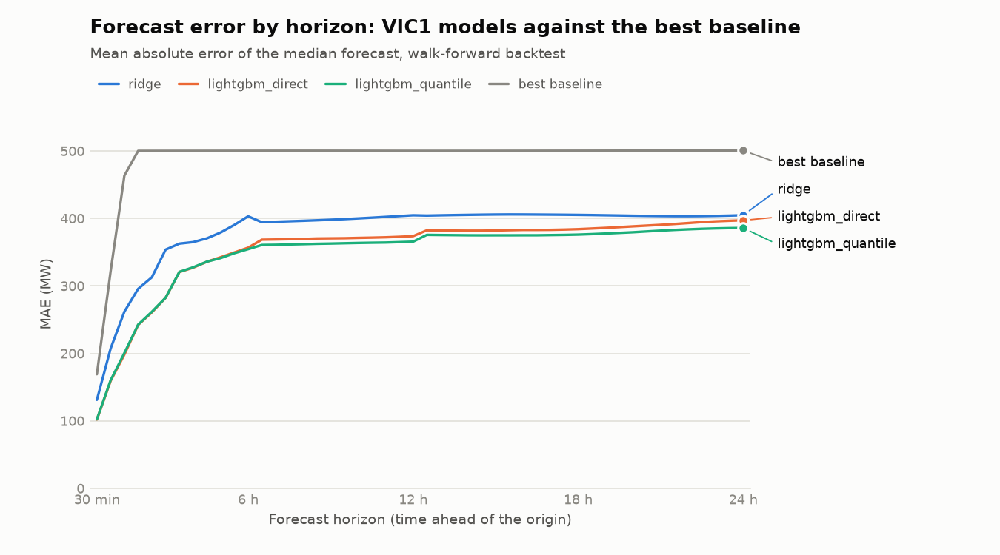

# Backtest: VIC1

Generated by `nem-forecast backtest` on 2026-11-06 08:14 AEST from commit `b35ebe4d287b4d3eb94d7cb62d99466307466823`. Baselines and models are scored on identical forecasts. Baselines are fixed rules and were not tuned; LightGBM hyperparameters were tuned on a validation split that ends where this backtest begins.

## Setup

- **Data:** AEMO 5-minute operational demand averaged to half-hours, 2023-10-01 to 2026-11-06.
- **Evaluation:** walk-forward over 2025-11-06 to 2026-11-06 (365 days). Expanding training window, refit every 30 days (13 refits), a forecast from every 30-minute origin, 48 half-hour horizons. 840,216 scored forecasts per model.
- **Intervals:** baselines use each rule's 10th and 90th error percentiles over the 90 days before each refit. Ridge and LightGBM direct use their own errors on the 28 days before each refit, predicted by a copy trained without those days. LightGBM quantile predicts its quantiles directly.
- **Time of day:** Melbourne wall-clock time of the target half-hour.

## Verdict

- `ridge`: Beats seasonal naive at all 48 horizons. Beats the best baseline at each horizon at all 48 horizons.
- `lightgbm_direct`: Beats seasonal naive at all 48 horizons. Beats the best baseline at each horizon at all 48 horizons.
- `lightgbm_quantile`: Beats seasonal naive at all 48 horizons. Beats the best baseline at each horizon at all 48 horizons.

## Overall

| Model | Kind | Description | MAE (MW) | RMSE (MW) | MAPE (%) | Pinball avg (MW) | 10-90 coverage (%) |
|---|---|---|--:|--:|--:|--:|--:|
| `seasonal_naive` | baseline | Same half-hour yesterday (t-48) | 502 | 746 | 10.8 | 177.6 | 79.9 |
| `weekly_seasonal_naive` | baseline | Same half-hour last week (t-336) | 593 | 893 | 12.9 | 210.4 | 79.2 |
| `same_weekday_mean_4w` | baseline | Mean of the same half-hour on the last 4 same weekdays | 500 | 716 | 10.8 | 178.7 | 74.3 |
| `persistence` | baseline | Last observed half-hour, held flat (demand at the origin) | 965 | 1,228 | 20.5 | 298.6 | 79.6 |
| `ridge` | model | Ridge regression on standardised lags and one-hot calendar, per horizon group | 382 | 551 | 8.2 | 130.3 | 78.1 |
| `lightgbm_direct` | model | LightGBM, squared error, one model per horizon group | 354 | 532 | 7.6 | 124.0 | 77.5 |
| `lightgbm_quantile` | model | LightGBM quantile regression at 0.1/0.5/0.9, one model per horizon group | 348 | 527 | 7.4 | 113.9 | 68.8 |

## MAE (MW) by horizon

| Model | 30 min | 1 h | 2 h | 3 h | 6 h | 12 h | 18 h | 24 h |
|---|--:|--:|--:|--:|--:|--:|--:|--:|
| `seasonal_naive` | 502 | 502 | 502 | 502 | 502 | 502 | 502 | 502 |
| `weekly_seasonal_naive` | 593 | 593 | 593 | 593 | 593 | 593 | 594 | 594 |
| `same_weekday_mean_4w` | 500 | 500 | 500 | 500 | 500 | 500 | 500 | 501 |
| `persistence` | 169 | 322 | 596 | 824 | 1,174 | 993 | 1,190 | 502 |
| `ridge` | 131 | 207 | 296 | 354 | 403 | 405 | 405 | 405 |
| `lightgbm_direct` | 102 | 159 | 242 | 283 | 357 | 374 | 384 | 397 |
| `lightgbm_quantile` | 102 | 160 | 243 | 283 | 355 | 366 | 376 | 386 |

## Pinball loss, average of q10/q50/q90 (MW), by horizon

| Model | 30 min | 1 h | 2 h | 3 h | 6 h | 12 h | 18 h | 24 h |
|---|--:|--:|--:|--:|--:|--:|--:|--:|
| `seasonal_naive` | 177 | 177 | 177 | 178 | 178 | 178 | 178 | 178 |
| `weekly_seasonal_naive` | 210 | 210 | 210 | 210 | 210 | 210 | 210 | 211 |
| `same_weekday_mean_4w` | 179 | 179 | 179 | 179 | 179 | 179 | 179 | 179 |
| `persistence` | 53 | 101 | 185 | 253 | 356 | 306 | 365 | 178 |
| `ridge` | 45 | 70 | 100 | 119 | 137 | 138 | 138 | 139 |
| `lightgbm_direct` | 35 | 55 | 84 | 99 | 125 | 130 | 134 | 139 |
| `lightgbm_quantile` | 36 | 54 | 80 | 92 | 116 | 120 | 123 | 125 |

## MAE change against seasonal naive, by horizon

Negative is better than seasonal naive.

| Model | 30 min | 1 h | 2 h | 3 h | 6 h | 12 h | 18 h | 24 h |
|---|--:|--:|--:|--:|--:|--:|--:|--:|
| `weekly_seasonal_naive` | +18% | +18% | +18% | +18% | +18% | +18% | +18% | +18% |
| `same_weekday_mean_4w` | -0% | -0% | -0% | -0% | -0% | -0% | -0% | -0% |
| `persistence` | -66% | -36% | +19% | +64% | +134% | +98% | +137% | +0% |
| `ridge` | -74% | -59% | -41% | -30% | -20% | -19% | -19% | -19% |
| `lightgbm_direct` | -80% | -68% | -52% | -44% | -29% | -26% | -23% | -21% |
| `lightgbm_quantile` | -80% | -68% | -52% | -44% | -29% | -27% | -25% | -23% |

## MAE (MW) by time of day

| Model | 00-06 overnight | 06-10 morning ramp | 10-16 solar trough | 16-21 evening peak | 21-24 late evening |
|---|--:|--:|--:|--:|--:|
| `seasonal_naive` | 215 | 534 | 816 | 565 | 303 |
| `weekly_seasonal_naive` | 293 | 512 | 959 | 685 | 420 |
| `same_weekday_mean_4w` | 237 | 462 | 787 | 590 | 355 |
| `persistence` | 857 | 860 | 1,057 | 1,145 | 843 |
| `ridge` | 212 | 351 | 599 | 422 | 263 |
| `lightgbm_direct` | 174 | 298 | 594 | 399 | 239 |
| `lightgbm_quantile` | 169 | 295 | 586 | 392 | 233 |

## Where the full numbers live

Every metric for every horizon and time-of-day bucket is in `model_run_metrics`
(`horizon = 0` and `tod_bucket = 'all'` are the pooled rows). Fold-level runs are in
MLflow, nested under each model's run.

| Model | model_runs.run_id | MLflow run |
|---|---|---|
| `seasonal_naive` | `e755ffd5-7624-49cc-ae43-6fff69ef92fe` | `9289db8eac364496a206f3497e430615` |
| `weekly_seasonal_naive` | `8c1eab6d-2298-4cdb-a890-46ddb335b640` | `23cd72688d5546fe83058e1e09bbe7a8` |
| `same_weekday_mean_4w` | `c1bdde2d-4ac2-4450-ba97-6a14d1f93a1d` | `23cd91c258ac4ee98a6b9887aded347c` |
| `persistence` | `37f0b8a0-981a-4f3b-a362-65394b5098e0` | `7deb503ac7c04ea19e472323baa44a50` |
| `ridge` | `99d1e68a-99ba-4455-81f0-a7a37591f9aa` | `16693b7fae4e4f85b104223a7006508a` |
| `lightgbm_direct` | `fdb03d0a-a98d-44be-8822-569743bdf4b5` | `9c8a9875e7694a42b9ead20dddc075c3` |
| `lightgbm_quantile` | `6eb85299-d1c5-4d0b-9a5d-547f8c1c863c` | `6c21c9b40b494df0874b7937e9156536` |
